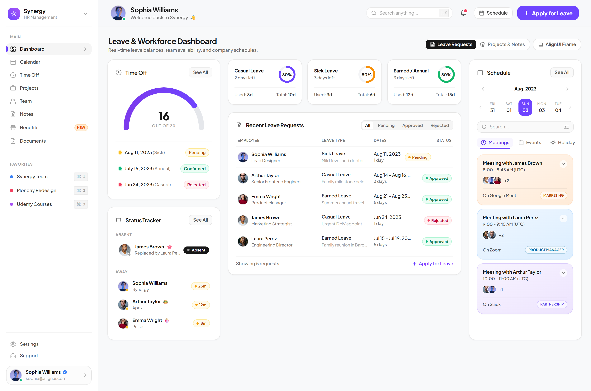

# Synergy HR — Employee Leave Management Dashboard

A high-fidelity Employee Leave Management SaaS Dashboard reverse-engineered from the **AlignUI** design language and Bento-grid architecture. Built with **React 18**, **Tailwind CSS**, and **Framer Motion**.



## 🌟 Key Features

- **Minimalist Bento Grid**: 3-column balanced architecture matching AlignUI visual guidelines, 8pt spacing grid, subtle borders, and soft shadows.
- **Time Off & Leave Balances**:
  - Semi-circular radial gauge indicator (`16 OUT OF 20`) with smooth SVG stroke animations.
  - 3 Minimalist Bento cards for **Casual Leave**, **Sick Leave**, and **Earned Leave** with circular percentage meters and remaining day counters.
- **Interactive "Apply for Leave" Modal**:
  - Framer Motion spring physics animation (`damping: 26, stiffness: 340`).
  - Blurred backdrop filter (`backdrop-blur-sm`).
  - Leave category selection with remaining balance hints, date pickers, half-day toggle, dynamic duration calculation, and handover contact selector.
  - Interactive confetti burst animation on submit with live state synchronization.
- **Recent Requests Data Table**: Clean data table with status filter pills (*All*, *Pending*, *Approved*, *Rejected*), employee avatars, leave durations, and inline one-click Approve/Reject actions.
- **Schedule & Company Holidays Widget**: Month switcher (`< Aug, 2023 >`), day selector row, search bar, and segmented tabs (*Meetings*, *Events*, *Holiday*) styled with soft pastel gradient cards (peach, sky blue, lavender).
- **Status Tracker**: Absent (*James Brown 🌸, Replaced by Laura Perez*) and Away (*Sophia Williams 25m, Arthur Taylor 12m, Emma Wright 8m*).
- **Dual Display Modes**: Seamlessly toggle between **Native Full-Screen View** and the **AlignUI Browser Mockup Frame** (with macOS window controls and `alignui.com` address pill).

## 🚀 Tech Stack

- **Framework**: [React 18](https://react.dev/) + [Vite](https://vitejs.dev/)
- **Styling**: [Tailwind CSS v3](https://tailwindcss.com/) + Custom Design Tokens
- **Icons**: [Lucide React](https://lucide.dev/)
- **Animations**: [Framer Motion](https://www.framer.com/motion/)
- **Typography**: [Plus Jakarta Sans](https://fonts.google.com/specimen/Plus+Jakarta+Sans)
- **Delight**: [Canvas Confetti](https://www.npmjs.com/package/canvas-confetti)

## 💻 Local Development

```bash
# Install dependencies
npm install

# Start Vite local development server
npm run dev

# Build for production
npm run build

# Preview production build
npm run preview
```

## 📦 Deployment

Deployed on **Vercel** with automatic CI/CD from GitHub.
